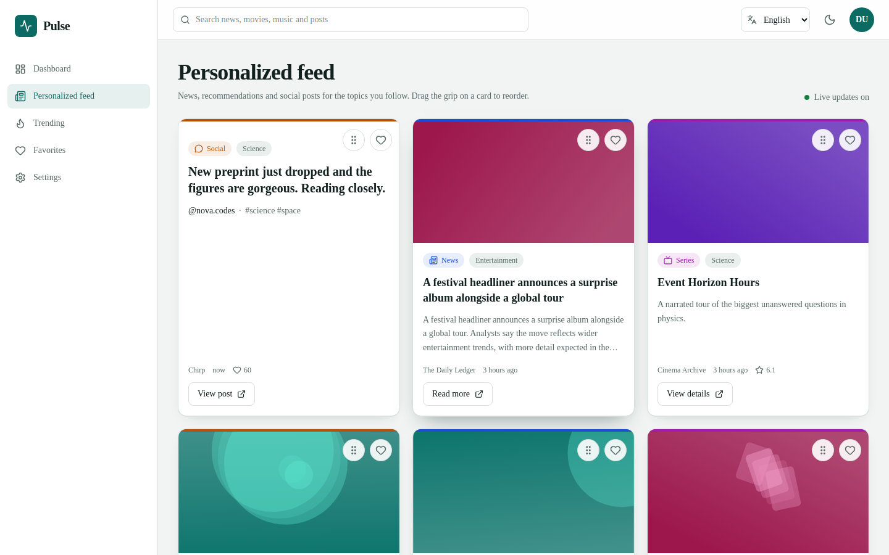
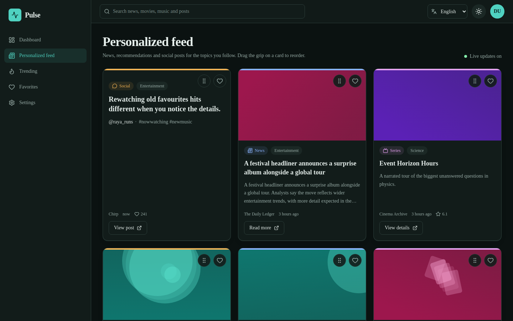
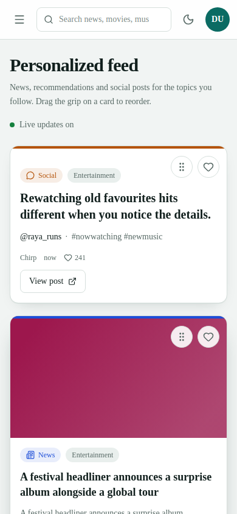

# Pulse — Personalized Content Dashboard

A responsive, accessible dashboard that merges **news**, **movie/music recommendations** and **social posts** into one personalised, drag-sortable feed. Built with Next.js 14 (App Router), React 18, TypeScript, Redux Toolkit + RTK Query, Tailwind CSS and Framer Motion.

It runs with **zero API keys**: with no keys configured, the server falls back to a realistic mock backend that behaves like a real async API (latency, pagination, simulated failures).

## Screenshots

| Light | Dark |
| --- | --- |
|  |  |



Regenerate with the app running: `PW_CHROMIUM_PATH=<optional> node scripts/screenshots.mjs`.

## Features

| Area | What you get |
| --- | --- |
| Personalised feed | Pick any of 7 categories in Settings; the unified feed (news + recommendations + social) is fetched for exactly those categories. Recommendations are also biased by the categories of items you have favorited. |
| Cards | Image, headline, description, source, category, relative time, type badge, favorite button and a type-specific CTA (Read / View post / Play / View details). |
| Infinite scroll | IntersectionObserver-driven paging with a "Load more" fallback button, duplicate prevention, end-of-feed message, inline error + retry when a later page fails. |
| Trending | Top-ranked news, recommendations and posts for your categories with rank badges and scores. |
| Favorites | Favorite from anywhere (feed, trending, search); state is shared through Redux so the same item is always in sync. Filter by type; clear-all with a confirmation modal. |
| Search | Header search across all three sources, results grouped by type, type filter, min. 2 chars, **400 ms debounce** (one request per settled query), loading / empty / error+retry states, clear button, recent searches. |
| Drag and drop | Reorder cards with the grip handle (pointer, touch or keyboard: Space to lift, arrows to move, Space to drop). Order is stored in Redux and persisted; "Reset order" restores the default. Favorite buttons and links keep working. |
| Dark mode | Class-based Tailwind dark mode driven by CSS custom properties; applied before first paint (no flash) and persisted. Every surface is themed. |
| Animations | Framer Motion page/card entrance, favorite pop, drawer and modal transitions, drag overlay. All respect `prefers-reduced-motion`. |
| Auth (bonus) | Mock email/password auth with a signed, httpOnly session cookie; sign up, sign in, sign out, protected routes, account menu. |
| Live updates (bonus) | The feed polls every 30 s (pausing while the tab is hidden), prepends new items and shows a "Live / updated" indicator. Transport-agnostic, so SSE/WebSocket can replace the poll. |
| i18n (bonus) | English, Español, हिन्दी via react-i18next with a working language switcher; persisted. |
| Accessibility | Semantic landmarks, skip link, labelled controls, visible focus, `aria-pressed`/`aria-current`, focus-trapped drawer and modal (Esc to close), polite live-region announcements, decorative images have empty alt. |

## Tech stack

Next.js 14.2 · React 18 · TypeScript (strict) · Redux Toolkit 2 + RTK Query · Tailwind CSS 3 · Framer Motion · dnd-kit (drag and drop) · react-i18next · Zod (env + request validation) · Vitest + React Testing Library · Playwright.

**Why dnd-kit instead of React DnD?** The brief allows any robust solution. dnd-kit has built-in keyboard sensors and screen-reader announcements and works with touch, which React DnD's HTML5 backend does not.

## Quick start

Requires Node.js 18.17+ (20+ recommended).

```bash
npm install
cp .env.example .env.local      # optional — leave keys blank for mock mode
npm run dev                     # http://localhost:3000
```

Sign in with **Use demo account** on the login page (`demo@pulse.dev` / `Demo@1234`), or create any account on `/signup`.

| Command | Purpose |
| --- | --- |
| `npm run dev` | Development server |
| `npm run build` / `npm run start` | Production build / serve it |
| `npm run type-check` | `tsc --noEmit` |
| `npm run lint` | ESLint (`next lint`) |
| `npm test` | Unit + component + integration tests (Vitest) |
| `npm run test:e2e` | Playwright E2E against a production build |

## Environment variables

All optional. Copy `.env.example` to `.env.local`. Keys are **server-side only** (no `NEXT_PUBLIC_` prefix), used by Next route handlers that proxy the upstream APIs, so they never reach the browser. `.env*` is git-ignored except `.env.example`.

| Variable | Purpose |
| --- | --- |
| `NEWS_API_KEY` | [NewsAPI](https://newsapi.org/) key. Blank → mock news. |
| `TMDB_API_KEY` | [TMDB](https://www.themoviedb.org/settings/api) v3 key. Blank → mock recommendations. |
| `AUTH_SECRET` | Signs the session cookie. `openssl rand -base64 32`. **Set it in production** (see Deployment). |
| `NEXT_PUBLIC_LIVE_POLL_MS` | Live-update polling interval, default `30000`. |
| `MOCK_DELAY_MS` | Simulated latency in mock mode, default `250`. |

Variables are validated with Zod; invalid values fall back to defaults with a console warning.

## API strategy and mock mode

```
Browser ── RTK Query ──► /api/feed | /api/trending | /api/search   (Next route handlers)
                              │
                              ├─ NEWS_API_KEY set?  ─ yes ─► NewsAPI   (else mock news)
                              ├─ TMDB_API_KEY set?  ─ yes ─► TMDB      (else mock recommendations)
                              └─ social: mock service (the brief allows a mock social API)
```

- Every source is **normalised into one `ContentItem` model** (`src/types/content.ts`) so cards, favorites, search and drag-and-drop are source-agnostic.
- Sources are fetched with `Promise.allSettled`: if one fails, the feed still renders the rest and shows a "some sources unavailable" notice.
- If a live source fails or is rate-limited, errors are mapped to friendly messages (`network`, `rate_limit`, `invalid_response`, `upstream`, …); no stack traces reach the UI.
- Mock data: 7 categories × 3 content types (deterministic apart from the time-based live post), with real pagination (`page`, `pageSize`, `total`, `hasMore`), simulated latency, and a deliberately generated "live" post each 30 s window.
- **Demo tools** (Settings → Demo tools) add an `x-simulate-error` header so you can see error and retry states on demand.
- Externally sourced text is stripped of tags/entities and URLs are restricted to `http(s)` (`src/lib/sanitize.ts`). No user-controlled HTML is rendered.

## Authentication (mock — read before deploying)

Auth is intentionally a **mock**: any well-formed email + 8+ char password creates a session, except the demo account which has a fixed password. Passwords are validated and discarded, never stored or logged. The session is a stateless HMAC-SHA256-signed token in an `httpOnly`, `SameSite=Lax` (and `Secure` in production) cookie, verified with a timing-safe compare. There is no user database. For real users, swap `src/lib/server/auth.ts` for Auth.js or your IdP.

## Architecture

```
src/
  app/                 Routes: /login /signup and the protected (app) group:
                       /dashboard /feed /trending /favorites /search /settings
    api/               Route handlers: feed, trending, search, news, social,
                       recommendations, placeholder (generated SVG art), auth/*
  components/
    layout/            AppShell, Sidebar (desktop + mobile drawer), Header, ThemeToggle,
                       LanguageSwitcher, AccountMenu, live-region announcer
    content/           ContentCard, FavoriteButton, SortableFeed (dnd-kit), CardGrid
    dashboard/         Feed / Trending / Favorites / Settings / Dashboard views
    search/            SearchBar, SearchView
    settings/          PreferencesPanel, Switch
    common/            EmptyState, ErrorState, Skeletons, Modal, ErrorBoundary
    auth/              AuthForm
  store/               configureStore, typed hooks, slices:
                       preferences · theme · favorites · feed (order, live) ·
                       search · ui · auth, + persist/hydrate/selectors
  services/api/        RTK Query API (contentApi)
  hooks/               useFeed, useDebouncedValue, useInfiniteScroll, useFocusTrap
  lib/                 order, sanitize, format, categories; lib/server/ (env, auth, sources, mock data)
  i18n/                en / es / hi
  tests/               unit/ components/ integration/ + shared utils
e2e/                   Playwright specs
```

Key decisions:

- **Persistence & SSR**: Redux starts with defaults on both server and first client render, then a `hydrate` action restores `localStorage` (`pcd:v1`) in an effect, so there are no hydration mismatches. An inline pre-paint script applies the saved theme class to avoid a flash. Persisted data is validated on load (corrupt or hand-edited storage is ignored, never crashes).
- **RTK Query feed**: one cache entry per category selection; pages are merged into it with de-duplication, so revisiting a section does not refetch.
- **Favorites store full items**, not just ids, so the Favorites page renders instantly and independently of any API.
- **Redux state is immutable** everywhere; reordering dispatches a new `order` array.

## Testing

```bash
npm test                 # 66 unit / component / integration tests
npm run test:e2e         # 28 Playwright tests (builds and serves the app itself)
```

First-time E2E setup: `npx playwright install chromium`.

| Layer | Covers |
| --- | --- |
| Unit | Every slice and reducer, selectors, content filtering, ordering helpers, persistence + corrupt-storage handling, sanitisation, formatting, debounce hook (incl. timer cleanup). |
| Component | ContentCard (all three types, CTAs, alt text), FavoriteButton (Redux + keyboard + cross-instance sync), preferences multi-select, theme toggle, empty / error / skeleton states. |
| Integration | Redux + RTK Query + UI with a mocked network: loading → success, requested categories, empty response, no categories, API error → friendly message → retry, partial source failure, pagination with de-duplication, favorites across views, search debounce (exactly one request for "react"), grouped results, empty / error / retry, min-length, clear, type filter. |
| E2E | Auth (guarding, bad password, validation, sign up/in/out, httpOnly cookie), search (debounce request count, grouping, filter, empty, error+retry, favorite from results), drag-and-drop (mouse, keyboard, persistence after reload, reset), navigation, infinite scroll, live updates (fake clock + stubbed refresh), trending, preferences persistence, favorites persistence, dark mode persistence, language switch, simulated outage, mobile drawer and no horizontal overflow at 375 px. |

## Deployment (Vercel)

1. Push to GitHub and import the repo in Vercel (framework preset: Next.js; defaults are correct).
2. Add environment variables (Project → Settings → Environment Variables):
   - **`AUTH_SECRET` (required for working sign-in on Vercel).** Without it each serverless instance generates its own random secret, so a session created on one instance is rejected by another.
   - `NEWS_API_KEY`, `TMDB_API_KEY` (optional; blank keeps mock mode).
3. Deploy. Or via CLI: `npm i -g vercel && vercel --prod`.

NewsAPI's free plan only allows requests from localhost; since calls are proxied through route handlers, check your plan's terms for production use.

## User flow

Open app → redirected to Login → demo account → Dashboard (greeting, highlights) → Personalized feed (preferences restored, mixed content loads) → search from the header → favorite cards → drag to reorder → Trending → Favorites → Settings (topics, language, theme, live updates) → reload: preferences, theme, favorites and card order are all restored.

## Known limitations

- Social data and authentication are mocks by design (see above). There is no real Twitter/Instagram integration.
- Live NewsAPI/TMDB code paths are implemented but need your keys to exercise; automated tests run against the mock backend and mocked network.
- Card images use plain `` (sources are arbitrary remote hosts or generated SVG, which `next/image` cannot optimise without a fixed domain allow-list).
- Favorites, order and preferences are stored per browser (localStorage), not per account.
- Spanish and Hindi strings have not been reviewed by native speakers.
